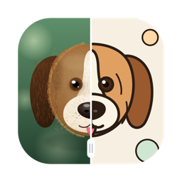
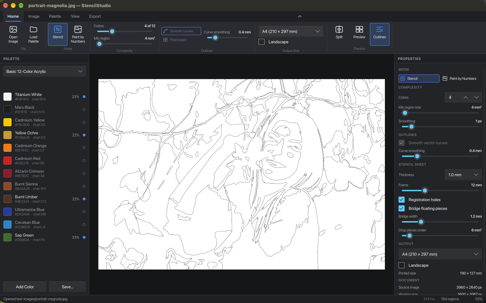
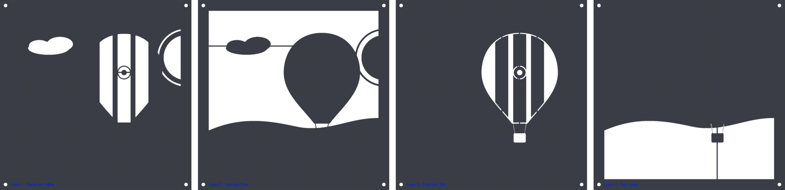
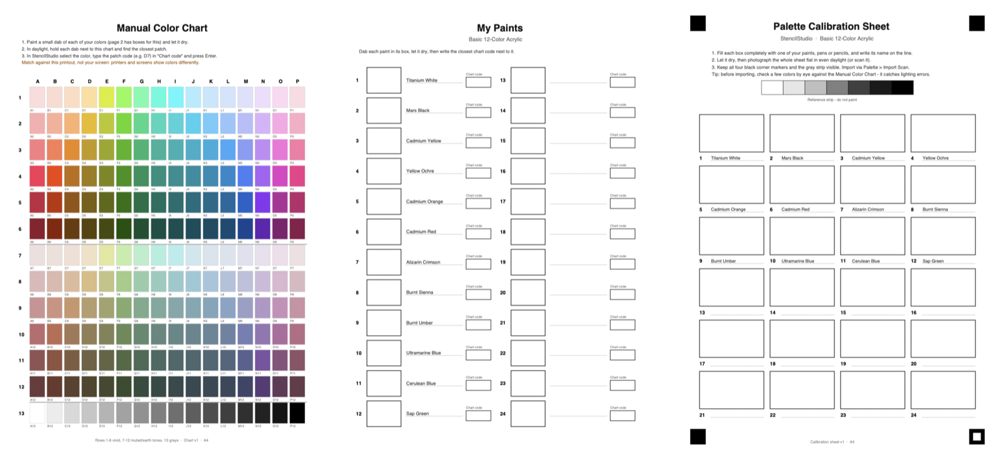

# StencilStudio

Turn any photo or illustration into **multi-layer stencils** (hand-cut, laser-cut or 3D-printed) or **paint-by-numbers templates**, using the colors of the paints, pens and pencils you actually own.


StencilStudio is a native, keyboard-and-mouse-first desktop app with a ribbon, menus and shortcuts. It's written in Rust with [Slint](https://slint.dev). macOS builds are available now; Windows, Linux, Android tablets and iPad are planned.

[](https://slint.dev)

## Download

macOS pre-release builds (universal: Apple Silicon + Intel, macOS 11+) are on the
[**Releases**](https://github.com/deveshrai/StencilStudio/releases) page.

These builds are ad-hoc signed and **not notarized**. The first time you open the app, right-click it and choose **Open**, or run:

```sh
xattr -dr com.apple.quarantine /Applications/StencilStudio.app
```

### Android (preview)

StencilStudio also runs on Android tablets and foldables (Android 10+, arm64). It has the same ribbon UI with touch on top: two-finger pinch to zoom, drag to pan, and keyboard shortcuts when a keyboard is attached. It has been tested on a Galaxy Z Fold and a Pixel Tablet emulator. Differences from desktop:

- **Open Image** shows an in-app browser of photos in Pictures, DCIM, Download and Documents. Android asks for photo access the first time.
- Exports and calibration PDFs are saved to **Documents/StencilStudio**, where you can open them in the Files app (and print from there).
- The desktop menu bar is hidden; everything is in the ribbon. On narrow screens, use the ‹ › buttons to scroll the ribbon.

To build: `scripts/build-android.sh --install <adb-serial>`. This needs the Android SDK with **NDK 30+** and **build-tools 37+**, plus `cargo install cargo-apk2` and `rustup target add aarch64-linux-android`. The APK is signed with your local debug key for sideloading.

## How it works

1. **Open an image.** Use JPG, PNG or WebP (`Ctrl+O`, or drop a path on the command line).
2. **Tell it which colors you own.** Pick a built-in palette, load or save your own, or let it derive colors from the image ("Auto").
   For an exact physical match, use the [manual color chart](#calibrating-to-your-real-paints).
3. **Choose a mode.** **Stencil** creates one cut sheet per color. **Paint by Numbers** creates an outline template.
4. **Tune it live.** Use these controls:
   - the number of colors;
   - the *minimum region size* in mm², measured at your chosen paper size, so nothing is too small to cut or paint;
   - curve smoothing;
   - pre-smoothing.

   The preview updates within about 0.1 s.
5. **Export.** Choose SVG or DXF for laser/vinyl cutters, or STL for 3D printing (`Ctrl+E`).

Colors are matched perceptually (CIELAB / CIEDE2000), not by raw RGB. When you limit the number of colors, StencilStudio picks the subset of *your* palette that best reproduces the image. It weighs that choice toward what you'd notice:

- **Vivid colors** count more, so a red subject stays red rather than turning into a "safe" brown.
- **Sharp, in-focus areas** count more (*Focus on subject*, on by default under **Image → Color Matching**), so a subject in front of a blurry background gets its colors first. In the hummingbird above, this is what keeps the red throat. Without it, the brown bokeh background takes that color slot.

## Stencil mode



The **Outlines** view (`Ctrl+3`) shows exactly where the cuts will be. Outlines are true vector curves:

- Each border between two colors is smoothed **once** and shared by both sides, so neighboring shapes always meet exactly. There are no slivers or gaps between layers.
- **Curve smoothing** is set in millimetres at the printed size, so the preview and the exported file match.

### Exported layers



*The four layers exported from the hummingbird at 4 colors: orange, blue, sienna, black (gray = sheet material, white = cut away).*

**Export** writes one file per color, lightest first, named `<name>-L<n>-<color>.<ext>`:

| Format | For | Details |
|---|---|---|
| **SVG** | Laser / vinyl cutters | mm units, red 0.01 mm hairline cuts, blue engraved layer label, Inkscape layers *Cut* / *Engrave* |
| **DXF** | Laser, CNC, CAD | AutoCAD R12 (widest compatibility), mm, layers `CUT` and `ENGRAVE` |
| **STL** | 3D printing | Watertight, manifold sheet at your chosen thickness (0.6–3 mm, e.g. 0.8 / 1 / 2 mm) |

Every layer gets a **solid frame** (12 mm by default) and **four round registration holes** in the same place on every sheet. Push pins or dowels through them to line the layers up while you paint.

### Layers view: see and edit bridges


**Layers** (`Ctrl+5`, or *Preview → Layers*) shows each stencil sheet exactly as it will be cut. Pick a layer from the chips at the top.

- **What you see:** cut-outs in the layer's paint color on the sheet material. Automatic bridges are **blue**, bridges you added are **green**, and anything still floating is **red**.
- **Click a bridge** to remove it.
- **Click inside a cut** to add a bridge across it at that spot. It runs horizontally or vertically, whichever is shorter, to the material on both sides. Clicking works with a finger too.
- **Undo** with `Ctrl+Z`. **Reset bridges** returns the layer to automatic.
- **Exports match:** edits are stored in millimetres on the sheet, so SVG, DXF and STL exports contain exactly what you see.

### Floating pieces and bridges

Some cut-outs leave a piece of sheet with nothing holding it, like the center of an "O" or the pupil of an eye. That piece would fall out. StencilStudio decides how to handle each one by its size:

- **Large enough pieces** are held by **two thin bridges on opposite sides**. Each bridge is a straight strip to the nearest solid material; left+right or up+down is chosen, whichever is shorter. In the black layer above (bottom right), the whole bird would otherwise drop out of the sheet; bridges hold it in place.
- **Tiny pieces** (below *Drop pieces under*, 6 mm² by default) are dropped, which simply makes that spot part of the paint area.
- **Mid-size pieces** are also dropped when their bridges would be much longer than the piece itself, instead of being held by long spindly strips. Pieces of 100 mm² or more are always kept.

Bridge width (default 1.2 mm), the drop size and an on/off switch are in **Export → Floating Pieces** and in the Properties panel. All three export formats get the bridges. After each export, the status bar reports how many pieces were bridged and how many were dropped.

## Paint-by-numbers mode


Paint-by-numbers uses the same color engine and minimum-region rules, so every cell is big enough to paint. Outlines can be **smooth vector curves** or **pixel-exact**.
*(Number placement and the printable PDF packet with a color legend are next on the roadmap.)*

## Calibrating to your real paints



Paint on paper never looks quite like it does on screen, so StencilStudio offers two printable aids (**Palette** tab, or **File → Calibration**). They print on A4 or US Letter, following your selected paper size.

**Manual Color Chart** (`Ctrl+P`), which you match by eye:

1. Print the chart. Page 1 has 208 color patches with grid codes: 6 vivid rows, 6 muted/earth-tone rows and a gray row. Page 2, *My Paints*, has a box for each of your colors.
2. Dab each paint in its box and let it dry.
3. In daylight, hold each dab next to the chart and find the closest patch.
4. In the app, select that color in the palette, type the patch code (e.g. `D7`) in the **Chart** field, and press Enter.

The palette list shows each color's nearest chart code, so you can also check existing colors at a glance. You match against the *printout*, not the screen, which removes most of the screen-vs-printer mismatch.

**Scan Sheet**, which you fill in, photograph and import:
24 boxes surrounded by corner markers and a gray reference strip, designed for automatic reading from a phone photo. *(The importer is in progress.)* Even with the scan sheet, we recommend one eyeball check against the manual chart before importing. It catches lighting and camera white-balance errors.

## Keyboard shortcuts

`Ctrl` = `⌘` on macOS. The full list is under **Help → Keyboard Shortcuts** (`Ctrl+/`).

| Keys | Action |
|---|---|
| Ctrl+O | Open image |
| Ctrl+E | Export stencil layers (SVG) |
| Ctrl+P | Print manual color chart |
| Ctrl+1 / 2 / 3 / 4 | Original / Preview / Outlines / Split view |
| Ctrl+5 | Stencil layers (click to add/remove bridges) |
| Ctrl+Z | Undo bridge edit |
| Ctrl+= / Ctrl+- / Ctrl+0 | Zoom in / out / fit (Ctrl+scroll zooms at the cursor; drag to pan) |
| Ctrl+Alt+0 | Actual pixels |
| Ctrl+] / Ctrl+[ | More / fewer colors |
| Ctrl+Alt+S / P | Stencil / Paint-by-Numbers mode |
| Ctrl+Alt+L / R | Toggle palette / properties panel |
| Ctrl+F1 | Collapse the ribbon |

## Building from source

Requires a recent stable Rust toolchain.

```sh
cargo run -p stencil-studio                     # run the app
cargo run -p stencil-studio -- photo.jpg        # open an image directly
cargo test --workspace                          # run the tests
scripts/package-macos.sh                        # universal .app + zip in dist/
scripts/build-android.sh --install <serial>     # Android APK in dist/ (+ install)
```

Developer tools:

```sh
# Full pipeline without the UI: previews + per-layer SVG/DXF/STL
cargo run -p stencil-core --release --example reduce -- in.jpg 4 out_dir/ [palette.json]
# Calibration PDFs
cargo run -p stencil-core --example calibration_sheet -- sheet.pdf [letter]
```

| Crate | Purpose |
|---|---|
| `crates/stencil-core` | UI-free engine: color science, palette selection, segmentation, smooth vectorization, stencil sheets & bridges, SVG/DXF/STL writers, PDF calibration sheets. |
| `crates/stencil-studio` | The Slint app (desktop binary + Android `cdylib`). UI in `ui/*.slint`; platform differences (file dialogs, saving, printing) in `src/platform.rs`; live processing on a background thread; exports run at higher resolution on their own thread. |

<details>
<summary>How the engine works</summary>

1. The image is downscaled to ≤1600 px for the live preview (≤3000 px for export) and optionally pre-blurred.
2. A 5-bit-per-channel histogram is converted to CIELAB.
3. **Palette selection** picks the *k* colors from your palette that minimize the pixel-weighted CIEDE2000 error (greedy + swap refinement), with chroma-weighted saliency. *Auto* mode runs weighted k-means++ instead.
4. Pixels are mapped to the chosen colors and labeled into 4-connected regions. Regions smaller than the minimum size (mm² at print size) merge into the neighbor they share the longest border with.
5. **Vectorization:** region borders are split into chains between junctions. Each chain is Gaussian-smoothed once with its ends pinned, so every outline built from them shares identical edges.
6. **Stencil sheets:** for each color, solid material = frame + every other color. Floating pieces are bridged or dropped on a pixel mask; the smooth outlines are then merged with the bridges using a robust polygon union (i_overlay), which also removes any self-intersections.
7. **STL:** ear-clipping triangulation with tiny deterministic jitter (removes collinear T-junctions) and pinch-point separation, so the mesh is strictly manifold.

</details>

## Roadmap

- **0.1.0:** engine, app shell, live preview, palettes; smooth vector stencils; SVG/DXF/STL export; scan sheet; macOS build.
- **0.1.1:** bridges for floating pieces (size-aware drop/bridge), manual color chart + chart codes, README walkthrough.
- **0.1.2:** *Focus on subject* color selection; STL robustness fixes found on high-res photos; new screenshots.
- **0.1.4:** Layers view with click-to-add/remove bridges and undo; new puppy app icon.
- **Next:** kerf offset, paint-by-numbers numbers + PDF packet, scan-sheet import (with an eyeball-check step), color wheel, crop/contrast/background removal, project files.
- **Android preview:** same app on tablets/foldables; in-app image browser, pinch-zoom, touch-friendly ribbon.
- **Later:** Android system photo picker & share/print intents, 3MF, paint-mixing suggestions, Windows/Linux packages, iPad build.

*Screenshots use royalty-free stock photos, for demonstration only. They are not included in the repository. `docs/sample/balloon.jpg` is an original illustration made for this project that you can use for testing.*
